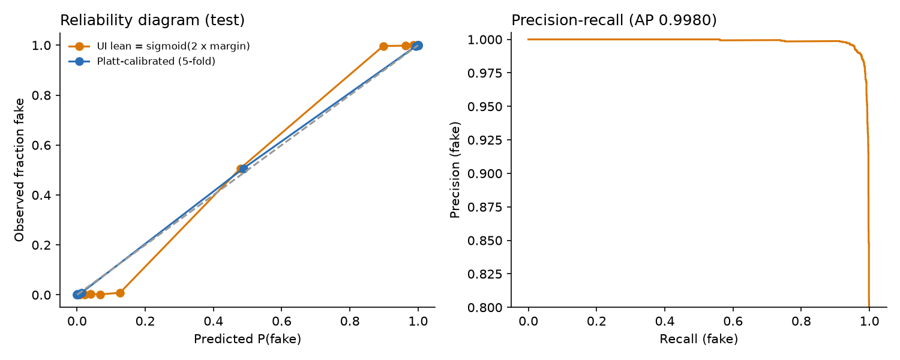

# ML audit — TF-IDF + Linear SVM (C = 5)

Generated by `audit/ml_audit.py`. Every number below is computed by that script from the project's data and
saved model; rerun it to reproduce. Positive class = fake.

## 1. Split reproduction

Experiment 3's split was reproduced from the raw CSVs (44,898 raw → 38,658 after removing
empty and duplicate articles → 27,060 / 5,799 / 5,799). Matches the saved `test.csv`: **True**.

## 2. Duplicates and near-duplicates

- Identical cleaned texts: test also in train **61**, val in train **51**, test in val **15** (Experiment 3 de-duplicated on raw title + text, so texts that become identical after cleaning can survive: 278 such duplicates overall; 5 texts are empty after cleaning).
- Test articles whose nearest training article has TF-IDF cosine similarity ≥ threshold: >= 0.99: **62**, >= 0.95: **89**, >= 0.9: **112**, >= 0.8: **215**.

## 3. Held-out test metrics

| Evaluation | n | Accuracy | Precision | Recall | F1 | ROC-AUC | PR-AUC | FPR | FNR |
|---|---|---|---|---|---|---|---|---|---|
| Test set (as reported in Experiment 6) | 5,798 | 0.9840 | 0.9880 | 0.9763 | 0.9821 | 0.9981 | 0.9980 | 0.0097 | 0.0237 |
| Test set without near-duplicates (cos < 0.9) | 5,686 | 0.9836 | 0.9879 | 0.9760 | 0.9819 | 0.9981 | 0.9980 | 0.0100 | 0.0240 |

Confusion matrix (test): TN 3,149 · FP 31 (real flagged fake) · FN 62 (fake missed) · TP 2,556.

## 4. Shortcuts and leakage in the dataset

| Artefact | % of real | % of fake |
|---|---|---|
| contains '(Reuters)' | 99.2 | 0.0 |
| starts with an all-caps dateline | 84.7 | 0.0 |
| contains 'featured image' | 0.0 | 46.7 |
| contains 'getty images' | 0.0 | 22.6 |
| contains 'pic.twitter.com' | 0.0 | 15.4 |
| contains 'said' | 93.7 | 56.8 |
| title is mostly upper-case words | 0.0 | 5.4 |

- `subject` values are disjoint between classes (overlap: none) — real: politicsNews, worldnews; fake: Government News, News, US_News, left-news, politics. The model does not use this column, but any feature derived from it would be pure label leakage.
- Date ranges differ: real 2016-01-13 → 2017-12-31, fake 2015-03-31 → 2018-02-19 (6 unparseable dates).
- **Shortcut probe:** a TF-IDF + SVM trained on only the **first 12 words** of each article reaches accuracy **0.9434** (ROC-AUC 0.9863). Datelines such as "WASHINGTON (Reuters) -" sit there, so the label is largely readable from the opening words.
- **Ablation:** deleting the single word "said" from test articles changes accuracy from 0.9840 to **0.9778** (FPR 0.0321).

## 5. Calibration

| Probability | Brier score | ECE (10 bins) |
|---|---|---|
| ui_sigmoid_2x_margin | 0.0186 | 0.0568 |
| platt_calibrated_cv5 | 0.0121 | 0.0034 |

The SVM outputs a margin, not a probability. Neither row is a probability that an article is *true*: both only estimate
P(label = fake) for articles drawn from this dataset. The UI therefore labels the bar as a writing-style score.

## 6. Generalisation tests (retrained TF-IDF + Linear SVM, C = 5)

| Evaluation | n | Accuracy | Precision | Recall | F1 | ROC-AUC | PR-AUC | FPR | FNR |
|---|---|---|---|---|---|---|---|---|---|
| Time split: train before 2017-07-01, test after | 15,587 | 0.9394 | 0.7467 | 0.9829 | 0.8487 | 0.9947 | 0.9834 | 0.0696 | 0.0171 |
| Topic shift: train on some subjects, test on others | 19,813 | 0.9361 | 0.9216 | 0.9522 | 0.9366 | 0.9851 | 0.9865 | 0.0799 | 0.0478 |

Time split class counts — train: {'real': 8302, 'fake': 14763}, test: {'real': 12894, 'fake': 2693}. Topic shift — real: politicsNews; fake: politics, left-news, Government News → real: worldnews; fake: News, US_News, Middle-east.
